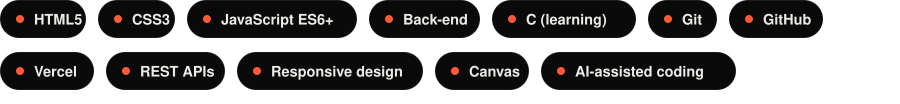

<div align="center">




<p>
  <a href="https://www.instagram.com/rrrudra_18/"></a>
  <a href="https://www.instagram.com/thegalacticrudra/"></a>
  <a href="https://www.linkedin.com/in/rudra-koregave-2b6547424/"></a>
  <a href="mailto:vivariumextimus@gmail.com"></a>
</p>


</div>

## `$ whoami`

```text
rudra@kernel:~$ cat about.txt
Name       : Rudra K.  (SAM)
Studying   : B.Tech, Information Technology '30 · NMIMS Shirpur
Based in   : Mumbai, Maharashtra
Building   : websites, small apps and a scroll-driven 3D portfolio
Learning   : C, back-end development, better software habits
Also       : esports in-game leader · video editor · cinematographer · actor

rudra@kernel:~$ echo $MOTTO
Beyond Logic. Beyond Limits. Beyond Ordinary.
```

I'm a curious IT student with a creative streak. I like turning random ideas into things people can click, play and use, and I'm always chasing the next thing I don't know yet.

<div align="center"></div>

## `./stack`

<div align="center"></div>

<div align="center"></div>

## `./projects --featured`

| | Project | What it is |
|---|---|---|
| 01 | [**R-s-Portfolio**](https://github.com/RudraKernel/R-s-Portfolio) | My portfolio: dark, scroll-driven and 3D, with a project dome, 45 playable builds, a visitor wall and a cinematic résumé. |
| 02 | [**Ajeya-26**](https://github.com/RudraKernel/Ajeya-26) · [live](https://sakshamxdaksh-phi.vercel.app/) | A career and micro-gig platform that helps students and job seekers find skills, earn through small tasks and gain practical experience. |
| 03 | [**R-s-Poems**](https://github.com/RudraKernel/R-s-Poems) · [live](https://r-s-poems-2uqi.vercel.app/) | A poetry website, written and made by me. |
| 04 | [**BeYogaWise**](https://beyogawise-omega.vercel.app/) | A live website I built for my mom, a yoga teacher, to present her classes online. |
| 05 | [**first-pr-festival**](https://github.com/RudraKernel/first-pr-festival) | Fork of Jay-Naik2526/first-pr-festival (TypeScript). |

> 45 more HTML, CSS and JavaScript builds (dashboards, kanban, e-commerce, chat, weather, code playground) are playable on my portfolio.

<div align="center"></div>

## `./activity`

<div align="center">
<picture>
  <source media="(prefers-color-scheme: dark)" srcset="https://raw.githubusercontent.com/RudraKernel/RudraKernel/output/github-snake-dark.svg">
  <source media="(prefers-color-scheme: light)" srcset="https://raw.githubusercontent.com/RudraKernel/RudraKernel/output/github-snake.svg">
  
</picture>
</div>

<div align="center">



</div>
